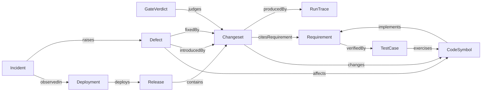
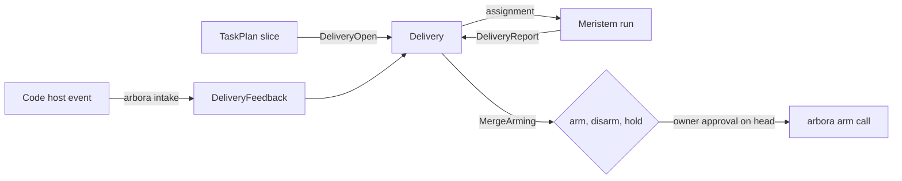

# MEDULLA-SDLC — Implementation plan

Governing spec: [spec.md](spec.md).
Code: ../../crates/medulla-compute/src/parser/tree_sitter.rs ../../crates/medulla-server-router/src/dispatch/router/source_ingest.rs

## Summary

The engine holds the whole software lifecycle as typed records. This plan extends that chain with spec artifacts as graph records. A deterministic parser ingests specs, rows, plans, tasks and contracts with the repository code graph. Per-file digests keep the ingest incremental. Competency questions, task dispatch, a research loop and typed proposals read those records. The existing owners are reused: MEDULLA-SCM for changesets and gates, MEDULLA-REPO-INGEST for code items, and MEDULLA-DECISION-ENGINE for decisions. Row R019 adds the autonomous delivery of each slice as a pull request, with feedback routing and an owner-only merge verdict.

## Technical Context

- **Language/Version**: Rust 2024 (engine), Python 3.14 (served tests)
- **Primary Dependencies**: `medulla-core`, `medulla-source-types`, `medulla-h-ingest`, `medulla-h-decide`, `medulla-sdlc`, `medulla-compute` parser crate
- **Storage**: the one engine graph; no second store
- **Testing**: Rust crate tests and served Python tests at L3 and L4 through the wire
- **Target Platform**: the engine server executable on Linux
- **Project Type**: service (native engine)
- **Performance Goals**: one-file spec change re-ingest under 1 s; full spec set under 30 s; competency answer p99 150 ms
- **Constraints**: no model call in ingest; no direct spec writes by the evolution loop; packs extend core classes
- **Scale/Scope**: 5,000 rows, 5,000 task lines and 50 contracts per repository

## Constitution Check

- Native Rust, single fact store: pass. Records, parser and decisions are Rust code in this repository. No second store exists.
- R-II Every wait has a deadline: pass. The ingest job and dispatch use bounded waits (R014.2, R015.1).
- R-III Every row sets budgets and names a benchmark: pass. Each new behaviour row names a budget and a bench group.

## Project Structure

```text
crates/medulla-compute/src/parser/spec_artifacts.rs                existing  deterministic parser (R014.1)
crates/medulla-core/src/lifecycle/                                 existing  derive, store, defect, status, trace (R001, R003, R005, R006)
crates/medulla-core/ontology/sdd-v1.ttl                            existing  lifecycle kinds and edges (R001.1)
crates/medulla-core/ontology/sdd-v1.shapes.ttl                     new       lifecycle shapes (R001.1)
crates/medulla-core/ontology/sdd-spec-v1.ttl                       new       spec artifact ontology pack (R014.5)
crates/medulla-core/ontology/sdlc_lifecycle-v1.ttl                 existing  delivery classes (R019.1)
crates/medulla-source-types/src/lifecycle.rs                       existing  records, Goal, ProjectMode, Proposal and ScenarioRun types (R001 to R006, R012.8, R013, R017)
crates/medulla-source-types/src/delivery.rs                        new       delivery records (R019.2)
crates/medulla-h-ingest/src/lifecycle.rs                           new       served lifecycle, mode, goal, proposal and delivery handlers
crates/medulla-h-ingest/src/lifecycle_tests.rs                     new       tenant-scope and refusal tests of those handlers
crates/medulla-h-ingest/src/source_ingestion/spec_projection.rs    new       spec document and artifact projection, incremental ingest, linking (R009, R014)
crates/medulla-h-decide/src/decide/triage.rs                       new       TriageDefect handler (R004.3)
crates/medulla-h-decide/src/decide/family/defect_triage.rs         new       DefectTriage decide family (R004)
crates/medulla-h-decide/src/decide/family/task_plan.rs             new       TaskPlan decide family (R015.1)
crates/medulla-h-decide/src/decide/family/task_context.rs          new       run-context assembly (R015.2)
crates/medulla-decision-outcome-types/src/decision/defect_triage.rs  existing  triage types, knobs and refusals (R004.1, R004.7)
crates/medulla-decision-stats/src/decision/defect_triage.rs        new       triage kernel (R004.8)
crates/medulla-competency/src/spec_artifact_questions.rs           new       spec artifact competency questions (R012.4, R014.6, R018.2)
crates/medulla-sdlc/src/lifecycle/                                 new       scenario, proposals, research and delivery logic (R013, R017, R019)
crates/medulla-server-router/src/dispatch/router/sdlc.rs           new       served lifecycle method arms (R002.3, R019.14)
crates/medulla-protocol-types/src/protocol/method/method_10.rs     existing  new Method variants (R002.3, R019.14)
scripts/ci_full_suite.py                                           new       complete-suite landing gate (R010, R011)
specs/development-lifecycle/contracts/                             existing  seam contracts
```

## Phase 0: Research

The budgets of R014.2 are starting defaults. A measurement on this platform replaces them. The delivery rows of R019 had five unknowns. [research.md](research.md) resolves each one.

1. Which events must reach a delivery, and how does the engine avoid waking a run for noise?
2. Which facts must hold before the platform may arm a merge, and who performs the arming?
3. How many automated review rounds should a delivery address?
4. How does a delivery recover after a restart without a repeated outside effect?
5. How does an owner gain trust before unprompted delivery starts?

## Phase 1: Design

### Existing system and reuse

| Need | Existing owner |
|---|---|
| Changeset record and accept path | MEDULLA-SCM-R002, MEDULLA-SCM-R003 |
| Gate verdict record | MEDULLA-SCM-R008 |
| Culprit search over the chain | MEDULLA-SCM-R009 |
| Run provenance on a changeset | MEDULLA-SCM-R012 |
| Code and test entities with byte spans | MEDULLA-REPO-INGEST-R600, `crates/medulla-compute/src/parser/tree_sitter.rs:249` |
| Commit and change-coupling graph | MEDULLA-REPO-INGEST-R601 |
| Source, test, spec and release bridge relations | MEDULLA-REPO-INGEST-R009 |
| Spec-folder typed nodes | MEDULLA-ORCH-VOCAB-R012 |
| Run trace records and step digests | MEDULLA-ORCH-VOCAB-R009, MEDULLA-ORCH-VOCAB-R013 |
| Operational incidents | MEDULLA-UNIFIED-DATA-PLANE-R760 |
| Replayable decision records | MEDULLA-DECISION-ENGINE-R007, MEDULLA-DECISION-ENGINE-R019 |
| Rule inference and closure | MEDULLA-FEDERATED-QUERY-R608 |

This spec adds three record kinds: Release, Deployment and Defect. It adds one edge vocabulary
and one derivation pass. It adds the triage decision and the status derivation. It adds no store.

### Architecture

#### Record kinds and edges



The ontology terms live in `crates/medulla-core/ontology/sdd-v1.ttl`. The SHACL shapes live beside
them. Existing classes keep their owners. `:Requirement` comes from MEDULLA-ORCH-VOCAB-R012.9.
`:Changeset` and `:GateVerdict` come from MEDULLA-SCM. `:CodeSymbol` and `:TestCase` map to the
MEDULLA-REPO-INGEST-R600 entities.

#### Derivation rules

Each rule is a named, versioned, deterministic function of the changeset log and the code graph.
A derived edge carries the rule name, the rule version and the input digests.

| Rule | Input | Output edge |
|---|---|---|
| `changes.span_overlap` | Changeset path spans at the parent and the new revision | `changes` Changeset to CodeSymbol |
| `cites.trailer` | Structured `spec_ids` of the changeset (MEDULLA-SCM-R002.1) | `citesRequirement` |
| `implements.cited_change` | `changes` plus `citesRequirement` on the default branch | `implements` CodeSymbol to Requirement |
| `verified.binding` | Test binding markers in the tree at a revision | `verifiedBy` Requirement to TestCase |
| `exercises.call_graph` | Test-to-symbol calls from MEDULLA-REPO-INGEST-R600 | `exercises` TestCase to CodeSymbol |
| `contains.release_range` | Release head and the previous release head | `contains` Release to Changeset |
| `introduced.bisect` | Culprit of MEDULLA-SCM-R009 | `introducedBy` Defect to Changeset |
| `fixed.trailer` | Structured `fixes` of the changeset | `fixedBy` Defect to Changeset |

Manual writes of a derived edge are refused. A rebuild replays the rules over the log and must
reproduce the edge set byte for byte.

#### Releases and deployments

A release names a repository, a version, a ref, the changeset head and the artifact digests. A
deployment names an environment, a workload, the image digest and the outcome. The engine links
a deployment to a release by artifact digest. A deployment with an unknown digest stays
`unattributed`. It never guesses a release.

#### Defect intake

Five paths open a defect. They are a failed gate verdict, a failed run trace and an incident.
The other two are a connector issue record and a direct filing. The engine computes a signature digest from the normalized
symptom. An open defect with the same signature absorbs the new symptom.

#### Defect triage

Triage is a choice, so the engine decides it. The decision reads the symptom frames, blame,
the bisect culprit, path ownership and recent authors. It proposes severity, suspected symbols,
an owner and a duplicate link. It abstains with a typed reason when evidence is insufficient.

#### Derived requirement state

The engine derives `SPECIFIED`, `LANDED` and `VERIFIED` per the shared spec standard.

```text
LANDED   := exists changeset C on the default-branch chain with ID in C.spec_ids
VERIFIED := LANDED and exists TestCase T in tree(head) with verifiedBy(ID, T)
rollup   := lowest state of its children
withdraw := a Spec-Withdraw trailer removes the binding evidence for that ID
```

The served answer carries the evidence: changeset ids and test ids. A generated `status.json`
remains an export of this answer.

#### Lifecycle queries

UQL answers the competency questions over the edge set. Four examples follow.

- Which requirements lack a bound test?
- Which deployment runs the code of a requirement?
- Which open defects affect symbols in a release?
- Which changesets differ between two deployments?

#### Spec artifact graph

The parser turns each artifact file into triples. Tables give Requirement records. Headings give PlanSection records. Task lines give Task records with T-id, parallel flag, story, row reference and checked state. Contract files give Contract records and `crossesSeam` edges. A store keeps one digest per file. A changed digest re-ingests only that file. A file that leaves the tree loses its records. Every ontology pack class extends a core class. The pack rolls up to the core.

Bundle plans under `releases/` and program plans ingest as plan records. A plan record links to the rows and tasks it covers. A question for the plan to reach a goal or phase returns plan sections with open tasks in order.

#### Project mode

Each codebase has a ProjectMode record: `reference`, `development` or `evolving`. A reference codebase never receives a proposal. Promotion to `evolving` needs operator approval. A Fixed knob protects that rule from the evolution loop.

#### Task dispatch, research and evolution

`Decide` with `TaskPlan` builds dependency layers from Task records. The engine assembles a context for each task and hands it to an agent run. The run result enters only through `SubmitChangeset` and the gates. A failure files a defect and raises evidence for a proposal. A plan unknown triggers research through the connectors. Findings return as cited proposals. Proposals have twelve closed kinds and land only as pull requests.

#### Autonomous delivery

A delivery is the record of one slice on its way to a merged pull request. R015.3 dispatches the slice, and R019.3 opens the delivery with an immutable mandate. Meristem runs each assignment and reports one of six states. Arbora turns check, review and merge events of the code host into `DeliveryFeedback` calls. The engine routes each event to the deliveries that follow its proposal. It derives the stage, counts automated review rounds and decides merge arming. The owner approval on the head commit is the only path to `arm`. The engine never merges, and arbora never merges as the platform principal. [data-model.md](data-model.md) lists the records. [quickstart.md](quickstart.md) runs the served journey.



#### Crate layers and the type slices (R021)

The layer order follows the dependency graph as it stands, most stable first: `contract` (wire and value types, the domain type slices, the capability ledger, the method codec), `kernels` (pure domain logic and modality kernels; no storage), `storage` (key-value store, transactions, caches, tables), `graph-core` (graph model, isolation, core facade), `engine` (compute, reasoning, the query front ends, planner, executor and the stores over the graph core), `service` (server API, authentication, persistence, change capture, mutation, operations, consensus), `handlers` (one crate per method family, and the wire listeners), `server` (router and server composition) and `adapters` (facade package, Python engine, cross-crate test harnesses). Storage sits below the graph core because `medulla-graph-core` builds on `medulla-storage` and `medulla-transaction`; persistence sits in `service` because `medulla-persistence` builds on `medulla-server-api`. On the day of filing the 151 crates hold this order with no upward edge, so the gate starts green with no allowance list.

The layers file names every crate. The gate reads the `[dependencies]` and `[build-dependencies]` tables, plain and per target, and follows a renamed dependency to its package. Dev-dependencies are not layered: a test may reach upward (`medulla-types` dev-depends on the domain slices that sit above it).

`medulla-types` keeps only what nearly every dependent uses: `contract` (identifiers, error codes, crypto, collections; 72 users) and `msgpack` (66 users), plus the value data model (`types`) and the small cursor and limit vocabularies. Everything else moves to the slice of its domain. The query plan AST and its wire DTOs (`wire` and its `wire_*` files, `series_expr`, `rdf_report`, `nl_query`, `search_source`) go to a new `medulla-query-types`. Access control (`acl`) then goes to `medulla-identity-types`; it moves after `wire`, because `wire_query_modalities` reads it and `medulla-types` cannot depend on a slice above it. The remaining domain modules go to the existing slice that owns the domain (source, catalog, agent, work, decision) or to a new slice when no slice owns it (finance, ingestion). Each Cargo feature that gates a moved type moves with it, and `medulla-protocol-types` forwards the feature. Each move is one change that updates every caller, adds no re-export and leaves no alias. A dependent then names only the slices it uses. The rule that no crate re-exports another crate's items is checked once the moves are done: on the day of filing 154 `pub use medulla_*` lines remain, 61 of them in `medulla-store`.

#### Explicit server state (R023)

`ServerContext` (`crates/medulla-server-api/src/server_context.rs`) owns the state that a process-wide static holds today. `src/main.rs` builds it once, `ServerContext::build(persist_dir, env)`, with the environment passed in as a lookup function, so the library reads no environment variable. `ServerState` holds it as `context: Arc<ServerContext>`, and every listener, handler and worker reaches it through the state it already holds. A test builds its own context with `ServerContext::fixture()`.

The first two fields set the pattern. The request-context policy is a `Result<RequestContextPolicy, String>`, resolved when the context is built; a missing variable stays a refusal at startup validation and on each request, as today. The replay ledger is a per-context lazy cell: the durable ledger opens on its first use under the context's state directory, so a server without authentication creates no ledger file, as today. `seal_replay_ledger` hands the window off at graceful shutdown. Each consumer takes the context as a parameter: `verify_request_with_security_dir(secret, req, dir)` becomes `verify_request_in(context, secret, req)`, and the `VerifiedRequestContext` constructors for service, broker, local-query, SQL-wire, Iceberg and replicated actors take `&ServerContext`. Two contexts in one process share no replay window, which the bound test proves. The fixture and test variants keep their current behaviour inside `build` (fixed policy triple, in-memory window). The test-harness state constructor (`ServerState::new_for_test`) shares one context built from the environment, `ServerContext::shared_for_tests`, because the integration tests provision their policy and ledger directory through the environment and build many states over one ledger. Once each test builds its own context, that shared context and the `request-policy-fixture` feature are deleted.

The remaining statics follow the same move, one change per group, in this order: the `medulla-server-api` caches and samplers (`denial_sample`, `icv_guard`, `identity_view`, `read_audit`, `schema_compose`, `txn` fences, `routed_write_coalescer` locks, `state` caps), then the knob install (`knob_config::INSTALLED`, which `ServerContext::build` takes as an argument instead), then the statics of the other crates by crate, server first.

#### Split of medulla-types: the module map and the order (R021.1 to R021.7)

Pre-untangled design for the rows R021.1 to R021.7, one line per answer.

- Owner. Medulla, the crate layer `contract`. A module goes to the slice that owns its domain by the spec named in its header comment.
- Cohesion. Types that change for one domain sit together; the 101 dependants of `medulla-types` then name only the slices they use.
- Dependency direction. Every slice depends on `medulla-types` only, plus `medulla-identity-types` for `medulla-query-types`. No slice depends on a slice above it, and the coupling gate checks it.
- Interface depth. A slice exports its modules by path. No crate re-exports another crate's items (R021.7).
- Special cases. None. Each module takes the same rule; the overrides are listed in the table.
- State. None. These are data types.
- Environment. None.

The order is: guard test (R021.2), policy move (R021.1), query types (R021.3), access control (R021.4), domain slices (R021.5), new slices (R021.6), re-export removal (R021.7). The lane compiles each group with `cargo check --workspace --all-targets --all-features` on a warm slot and runs the full test suite once after R021.6 (the split is all-or-nothing). The map below is the source of truth for every move; a module absent from it is a bug in the map.

| Destination crate | Modules | Count | Lines |
|---|---|---|---|
| `medulla-query-types` | `asr_wire`, `causal_wire`, `derived_fact`, `document_ops`, `graphlearn_nary`, `nl_query`, `plan_cache_key`, `quantum`, `rdf_report`, `search_source`, `sensitive_detect`, `series_expr`, `solve_scalar`, `telemetry_derive`, `topology`, `viz`, `wire`, `wire_datascience`, `wire_mining`, `wire_pipeline`, `wire_query_attribution`, `wire_query_core`, `wire_query_kinds`, `wire_query_modalities`, `wire_query_samples`, `wire_query_uql`, `wire_query_uql_modal`, `wire_query_uql_pred`, `wire_streaming` | 29 | 8259 |
| `medulla-identity-types` | `acl` | 1 | 376 |
| `medulla-mutation-types` | `atomic_primitive`, `benchmark_claim`, `branch`, `cross_store_scope`, `fast_path`, `graph_change_feed`, `health_incident`, `hot_store_engine`, `memory_sync`, `mirror_sink`, `pg_operational_surface`, `pipeline_batch`, `restore_drill`, `retention_cleanup`, `retention_policy`, `rule_correction`, `workload_class`, `write_conflict` | 18 | 3390 |
| `medulla-work-types` | `agent_bus`, `run_observation`, `scheduler_config`, `statechart`, `step_verdict`, `task_queue` | 6 | 1408 |
| `medulla-decision-types` | `belief_revision`, `claims`, `context_facts`, `correction`, `failure_patterns`, `loops`, `source_toc`, `usage` | 8 | 1903 |
| `medulla-catalog-types` | `architecture_view`, `asset_usage`, `attached_source_dialect`, `attached_source_governance`, `consolidation_isolation`, `data_product`, `dialect_conformance`, `document_conformance`, `embedding_promotion`, `engine_capabilities`, `entity_link_proposal`, `external_schema`, `glossary`, `gramps_baseline_digest`, `gramps_cutover_gate`, `gramps_gap_fix`, `gramps_pilot_phase`, `immich_pilot_phase`, `incident`, `metadata_acceleration`, `mysql_mariadb_connection`, `ontology_diff`, `ontology_edit`, `ontology_inspection`, `pg_diff_baseline`, `pgrx_spike`, `pgrx_spike_review`, `pitr_schedule`, `profile`, `quality`, `replay_conformance`, `schema_context`, `schema_inference`, `shared_db_platform`, `stewardship`, `virtual_graph_view`, `warehouse_conformance`, `warehouse_federation`, `web_source` | 39 | 7092 |
| `medulla-source-types` | `meeting_transcript`, `source_changeset`, `source_symbol_edit` | 3 | 477 |
| `medulla-finance-types` | `finance_event_envelope`, `finance_research`, `finance_wallet_trust`, `wire_finance` | 4 | 973 |
| `medulla-ingestion-types` | `code_health`, `data_prep_declaration`, `extracted_fact`, `ingest_capabilities`, `ingest_drain`, `ingest_readback`, `ingest_rules`, `ingestion_wire`, `knowledge_atom`, `knowledge_stream`, `ontology_proposal`, `skill_plan`, `source_governance` | 13 | 2472 |
| `medulla-types` (stays) | `concept_id`, `contract`, `delta`, `durability_class`, `durable_unit`, `evidence_class`, `keyset_page`, `lease_vocab`, `modality`, `msgpack`, `runtime_limit`, `tenant_cursor`, `types`, `transition_refused`, `test_support` | 13 | 2219 |

### Interfaces and data model

- `RecordRelease { tenant, repo, version, ref, changeset_head, artifact_digests }` returns the sealed release record.
- `RecordDeployment { tenant, environment, workload, image_digest, started_at, finished_at, outcome }` returns the deployment and its release link.
- `FileDefect { tenant, repo, intake, symptom, severity_hint? }` returns the defect id and the dedup outcome.
- `TriageDefect { tenant, defect_id }` returns the triage decision record.
- `TransitionDefect { tenant, defect_id, to, evidence_ref }` returns the new state.
- `SpecStatus { tenant, repo, rev, spec_id? }` returns each row state with its evidence.
- `LifecycleTrace { tenant, anchor, depth }` returns the reachable lifecycle records.

- `ProjectModeSet { tenant, repo, mode, approval_ref? }` returns the ProjectMode record.
- `GoalPut { tenant, repo, statement, targets }` returns the Goal record.
- `ProposalPut`, `ProposalList` and `ProposalDecide` write, list and decide proposals.
- `DeliveryOpen`, `DeliveryFeedback`, `DeliveryReport`, `DeliveryStatus`, `DeliveryList`, `DeliveryStop` and `DeliveryRetry` hold one delivery each (R019.14).
- `Decide` with `QuestionKind::MergeArming` returns `arm`, `disarm` or `hold` with its premises (R019.10).
- Contracts: [spec-artifact-graph](contracts/spec-artifact-graph.md), [proposal-review](contracts/proposal-review.md), [gate-verdicts-and-release](contracts/gate-verdicts-and-release.md), [task-run](contracts/task-run.md) and [autonomous-delivery](contracts/autonomous-delivery.md).

### Risks, alternatives, and decisions

- **Derived, not declared.** Agents never write lifecycle edges by hand. Rules derive them, so the graph cannot drift from the log.
- **Status from the graph.** The derived state replaces hand-run status files as truth. A file export stays for public pages.
- **Defect is not incident.** An incident is an operational event. A defect is a code fault. An incident may raise a defect.
- **Risk:** test binding markers vary by language. The `verified.binding` rule reads the two marker forms of the spec standard only.
- **Deterministic ingest.** A model call in ingest makes state irreproducible and slow. The parser reads fixed forms only.
- **Proposals are not writes.** A loop that edits specs directly bypasses review. Every change goes through a pull request.
- **Risk:** the parser refuses an unknown file form and names the file and line. Authors fix the source.
- **Owner-only merge.** The platform may open, revise and close its own pull requests. Only an owner approval on the head commit leads to `arm`, and no platform principal merges.
- **Shadow before autonomy.** An unprompted slice in mode `development` records what it would deliver. The owner reads those records before promotion to `evolving`.
- **Risk:** feedback noise wakes runs and costs model time. Check and bot events never resume an ended delivery, and automated review rounds have a budget.
- **Risk:** a restart repeats a pull-request comment or push. Effects without a receipt are `uncertain` and need reconciliation before a retry.

### North star

The engine drives development from its own graph. Specs, plans, tasks and contracts are records. A planner asks the next unblocked task and gets its context. Agent runs implement it, the gates accept it, and the evolution loop proposes improvements for review. The exit gate is the competency question set of `MEDULLA-SDLC-R014.6` answered through the served path (`MEDULLA-CQ-ORCH`).

### Delivery phase

Rows `R014` to `R018` serve P5. The next-task question of `R014.6` supports the execution-plan answer of `MEDULLA-CQ-ORCH-R012` in scenario `ARBORA-ACCEPTANCE-R006.7`. Row `R012.8` sets the mode that gates every proposal and has no phase of its own. Rows `R019` to `R019.15` serve P5 and land after the crate split. Rows `R001` to `R006` and `R012.1` to `R012.7` serve P1 to P4.

## Phase 2: Task approach

`tasks.md` holds one task line per row, producer first. Model rows come before behaviour, wiring and hot-path rows. Rows `R014.1`, `R014.5`, `R016.5` and `R017.2` carry `[P]` because they share no file with their siblings.
Rows `R019.1`, `R019.2`, `R019.6`, `R019.9` and `R019.12` carry `[P]` for the same reason.

## Complexity Tracking

None. The constitution check passed.

## Build contract

Standard repository gates apply: Clippy, tests, jscpd, CCCC, dupehound and KISS. The
derivation pass must pass the no-duplicate-authority check against MEDULLA-REPO-INGEST-R009. The
status derivation has a differential test against the shared status generator.

The ingest budget gates are the bench groups `lifecycle/spec_parse` and `lifecycle/spec_ingest`. The parser makes no model call, and a test proves it.

The delivery budget gates are the bench groups `lifecycle/delivery`, `lifecycle/delivery_feedback`, `lifecycle/delivery_stage` and `lifecycle/delivery_arming`. Each gates a 10 percent regression. The knobs `sdlc.delivery.owner_approval_required` and `sdlc.delivery.shadow_unprompted_in_development` are Fixed safety knobs. The knobs `sdlc.delivery.max_automated_review_rounds` (3) and `sdlc.delivery.arm_max_changed_lines` (400) are tunable starting values.

## Production caller chain

1. MEDULLA-SCM-R003 accepts a changeset. The accept path calls the re-index hook of MEDULLA-SCM-R006.
2. The re-index hook calls `derive_lifecycle_edges` in `crates/medulla-core/src/lifecycle/derive.rs`.
3. For an ingested git repository, the `Method::IndexRepository` arm (`crates/medulla-server-graph/src/dispatch/graph_pipeline/native_routes.rs:403`) calls `route_repository_index` (`crates/medulla-server-graph/src/dispatch/graph_pipeline/repository_index.rs:208`), which calls the same function.
4. `RecordGateVerdict` of MEDULLA-SCM-R008 calls the defect intake on a failed verdict.
5. arbora serves the methods above through `ARBORA-OPS-R853`. Each served lifecycle method enters at `dispatch_sdlc_methods` (`crates/medulla-server-router/src/dispatch/router/sdlc.rs`, chained at `crates/medulla-server-router/src/dispatch/router.rs:142`) and runs in `crates/medulla-source-types/src/lifecycle.rs`. `TriageDefect` enters beside `Method::Decide` (`crates/medulla-server-router/src/dispatch/router/decision_plane.rs:112`) and runs in `crates/medulla-h-decide/src/decide/triage.rs`.
6. The repository-manager ingest job calls `SourceIngest` (`native_routes.rs:399`). The scoped index commit in `crates/medulla-h-ingest/src/repository_index.rs` calls `reingest_changed_artifacts` in `crates/medulla-h-ingest/src/source_ingestion/spec_projection.rs`, which parses and links the spec artifacts (R014.8).
7. arbora serves the artifact reads, the run dispatch, the mode and the proposal operations through `ARBORA-OPS-R896`.
8. `run.dispatch` calls `Decide` with `TaskPlan`. The engine hands each task to a run through the MERISTEM-SCM task-run row. The result returns through `SubmitChangeset` and the gates.

9. arbora `development.run.start` dispatches a slice. `open_delivery` in `crates/medulla-sdlc/src/lifecycle/delivery/open.rs` opens its delivery (R019.3).
10. arbora receives a code-host event and calls `DeliveryFeedback`. `route_feedback` in `feedback.rs` routes it (R019.5).
11. arbora asks `Decide` with `MergeArming` before any arming call. `arming_verdict` in `arming.rs` answers (R019.10).

Obsolete paths: no hand-run status file is truth, and no spec file is written outside a changeset.

### Machine wiring

- `DefectMachine`: entry point served defect methods → `crates/medulla-core/src/lifecycle/defect.rs` → `DefectStatus::apply` in `crates/medulla-source-types/src/defect_machine.rs`, beside the enum so the trait impl stays in the defining crate; `crates/medulla-core/src/lifecycle/defect.rs` calls it → stored state field. Attach points: `defect.rs:84,132,141`. Wiring row: MEDULLA-SDLC-R030.1. Hot-path proof row: `no_writer_sets_state_outside_apply` of MEDULLA-SDLC-R030.1.

## Cross-repo seams

- `ARBORA-OPS-R853` and `ARBORA-OPS-R896.1` to `R896.4` serve the lifecycle, artifact, mode and run operations. Contract: `contracts/spec-artifact-graph.md`.
- `ARBORA-OPS-R896.5` and `OVERSTORY-DECIDE-R009` list and decide proposals. Contract: `contracts/proposal-review.md`.
- `PIPE-GATES-R004`, `PIPE-CONNSPEC-R009` and `PIPE-RELEASE-R025` publish verdicts, read the derived state and compute release plans. Contract: `contracts/gate-verdicts-and-release.md`.
- `MERISTEM-SCM-R011.2` performs one task run for `MEDULLA-SDLC-R015.3`. Contract: `contracts/task-run.md`.
- `ARBORA-OPS-R896` serves the delivery methods of `MEDULLA-SDLC-R019.14`. Contract: `contracts/autonomous-delivery.md`.

The decisions this spec consumes stay inside medulla: `MEDULLA-DECISION-ENGINE-R134.111`, `R705`, `R654`, `R811`, `R817`, `R805` and `R179`.

### Explicit state machines

Organization constitution Article XXXI requires a closed set of states, one transition function and a typed refusal for each machine. Rows `MEDULLA-SDLC-R030` apply it here. Each machine returns `TransitionRefused` (MEDULLA-ORCH-VOCAB-R811.4), stores its state in one field, and is described in `crates/medulla-core/ontology/state-machines-v1.ttl` with classes that roll up to the core state-machine classes. The change is a hard cutover: the old literals, flags and inferred states are deleted in the same release.
