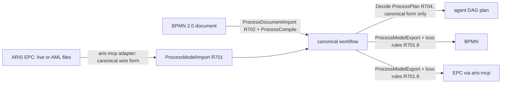
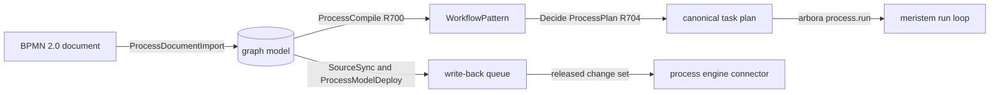

# MEDULLA-CQ-ORCH — Implementation plan

Governing spec: [spec.md](spec.md). Rows: [requirements.md](requirements.md).

## Summary

"How can I execute task XYZ?" is answered when it decomposes into seven separately answerable questions, each answered by one query over the ontology from connected data, and a composed answer carries all seven parts with provenance through the existing assembly handler. The live caller of the question vocabularies is `GraphSchemaSources::default()` in `crates/medulla-graph-core/src/graph/schema_sources.rs`; the composed answer enters at `dispatch_decision_methods` in `crates/medulla-server-router/src/dispatch/router/decision_plane.rs` beside `Method::AgentAssemble`. Reuse candidates found by searching the code first: `assemble_for`, `coverage_for` and `entailment_for` of `crates/medulla-h-decide`, the source-selection model of `crates/medulla-virtual-graph`, and the mining read path of `crates/medulla-h-mining`.

## Technical Context

- **Language/Version**: Rust 2021 edition on the pinned toolchain of `rust-toolchain.toml`; Turtle ontology and SHACL files; Python 3.14 (floor 3.12) for served tests.
- **Primary Dependencies**: `medulla-rdf` (parser, SPARQL), `medulla-shacl`, `medulla-reasoner`, `medulla-virtual-graph`, `medulla-h-decide`, `medulla-h-mining`, `medulla-h-graph` and the standard library.
- **Storage**: the engine graph store; workflows persist as versioned graph content through the mutation gateway. No second store.
- **Testing**: `crates/medulla-rdf/tests/orchestration_competency.rs` for questions 1 to 7, the unit tests named by the rows, and served L3 and L4 tests under `tests/`.
- **Target Platform**: Linux x86_64 and aarch64 hosts.
- **Project Type**: Library crates, ontology files and server handler crates.
- **Performance Goals**: the nightly groups `architecture_view`, `process_compile` and `process_import` of `MEDULLA-DECISION-ENGINE-R178.1` hold the budgets stated in rows R010.6, R700.6 and R701.6.
- **Constraints**: no second planner; every refusal has a stable code; reads write nothing; no version suffix in a name.
- **Scale/Scope**: the leaf rows of `requirements.md`, spread over 6 user stories and 6 `FR-` labels.

**Knob convention.** An engine knob named `knob x.y` in this spec's rows is a typed field of the server configuration, read from the command line or from the environment variable `MEDULLA_<NAME>` (the dotted name upper-cased, dots as underscores) and bounds-checked at startup: a value outside the stated range refuses startup with the knob name. Decision knobs are the exception and live only in the `MEDULLA-DECISION-ENGINE-R179` registry. Rows do not restate this.

## Constitution Check

- **R-I. The engine is native Rust and the only fact store**: pass. Every row lands in a Rust crate, an ontology file or an engine test.
- **R-II. Every wait has a deadline**: pass. No row adds a wait.
- **R-III. Every row sets budgets and names a benchmark**: pass. Rows R010.6, R700.6 and R701.6 name the nightly groups.
- **R-IV. Crates are small, layered and cut over hard**: pass. Rows name post-split crates; no handler crate calls a sibling handler crate.
- **Organization standards**: pass. Rows follow the spec standard and the ecosystem boundaries.

## Project Structure

```text
crates/medulla-core/ontology/orchestration-v1.ttl, capability-v1.ttl, swarm_topology-v1.ttl  existing
crates/medulla-core/ontology/orchestration-v1.shapes.ttl, swarm_topology-v1.shapes.ttl      existing
crates/medulla-core/tests/fixtures/orchestration_competency/q1..q7/                         existing
crates/medulla-rdf/tests/orchestration_competency*.rs                                       existing
crates/medulla-decision-outcome-types/src/decision/execution_answer.rs                      existing
crates/medulla-types/src/architecture_view.rs                                               existing
crates/medulla-h-decide/src/decide/execution_answer.rs                                      new
crates/medulla-h-mining/src/mining/architecture.rs                                          new
crates/medulla-h-graph/src/graph_ops/process_compile.rs                                     new
crates/medulla-core/src/{architecture_view,process_compile,process_import}.rs               new
crates/medulla-types/src/process_import.rs                                                  new (canonical workflow records)
crates/medulla-core/tests/fixtures/process_equivalence/                                     new (BPMN, AML, golden canonical)
tests/orchestration/, tests/competency/                                                     new served tests
```

## Phase 0: Research

No unknowns. The two earlier open questions are resolved by the code: `AgentTemplate` is declared in `orchestration-v1.ttl`, and step order reuses the core `:precedes` property.

## Phase 1: Design

### Layer model

| Layer | Contents | Read by |
|---|---|---|
| L0 | Sources and ontologies | Q1, Q4, composed answer |
| L1 | Components: tools, skills, prompts, model profiles | Q3, Q4, Q5, composed answer |
| L2 | Agents and the Agent Library | Q2, Q3, Q5, composed answer |
| L3 | Agent graphs | Q1, Q2, Q6, Q7, composed answer |
| L4 | Harness port | Q6, composed answer |
| L5 | Runs, outcomes and feedback | Q1, Q2, Q6, composed answer |

Composition is the engine's decision functionality: `graph.assemble()` (`MEDULLA-DECISION-ENGINE-R036`) lowers typed tasks and capabilities to a bounded 0-1 program and returns a certified assembly or a typed abstention. Cross-source answers use federated query and foreign sources. A question is answered when one query over the ontology returns a correct, provenance-carrying answer; otherwise the answer is a typed abstention.

### Questions 1 to 7

| Question | Terms (as built) | Shape | Fixture source | Rows |
|---|---|---|---|---|
| Q1 steps | `:TaskStep`, `:hasStep`, core `:precedes` | `TaskStepShape` | task-decomposition | R001 |
| Q2 staffing | `:AgentKind`, `:hasAgentKind`, `swarm:requiresAgentKind` | swarm slot shapes | topology-templates | R002 |
| Q3 template coverage | `:AgentTemplate`, `:AgentLibrary`, `:memberOfLibrary` | `LibraryMemberShape` | agent-library | R003 |
| Q4 guardrails | `:BestPractice`, `:appliesToTaskClass` | `RuleScopeShape` | guardrail-rules | R004 |
| Q5 bindings | `:ModelProfile`, `:needsSkill`, `:stepAssignedAgent` | `StepBindingShape` | assembly | R005 |
| Q6 workflow | `:handsOffTo` | `HandOffShape` | workflow-store | R006 |
| Q7 DAG | `swarm:feeds` | `FeedsAcyclicShape`, `FeedsSingleRootShape` | topology-templates | R007 |

Each question has a fixture directory with `fixture.ttl`, `query.rq` and `expected.tsv`; the acceptance test asserts that every row carries its source and that an unconnected source yields the typed abstention.

### Composed answer

`AgentExecutionAnswer` returns `ExecutionAnswer{task_iri, parts{steps, staffing, coverage, guardrails, bindings, workflow, dag}, assembled_by, certificate_digest}`. Each part is an answer or a typed abstention with provenance and an evidence class. The handler runs `assemble_for` once, reads coverage and guardrails through their existing functions and runs the fixture queries of Q1, Q6 and Q7. It adds no planner. Rows R008 and R012.

### Probes

Six probe questions are answered by existing engine paths (`NlQuery`, `Decide`, `AgentLibrary`, `Discover`). Medulla owns the engine answer and its fixture; arbora owns intent resolution and proves the same answers through the intent tools. Row R009.

### Architecture views

Data flow: `Method::ArchitectureView` → `crates/medulla-h-mining/src/mining.rs::try_handle` → `handle_architecture_view` (new) → `derive_architecture_view` (new, `crates/medulla-core/src/architecture_view.rs`) → `ArchitectureView` with containers, edges and support paths. `medulla-h-mining` depends on `medulla-core` for the derivation (a downward dependency; the layering holds). The view has its own read method; `handle_impact` serves risk propagation and is not the call site. Failure behaviour: a scope with no supporting source returns a typed refusal; a diagram element with no matching package stays a container with empty support. Decision: derive on read from the graph; a stored diagram per repository goes stale at the next ingest. Row R010.

### Job and plan questions

| Question | Mechanism |
|---|---|
| load set for job J | `MEDULLA-DECISION-ENGINE-R176` |
| next downtime jobs | `MEDULLA-DURABLE-KERNEL-R101` |
| best virtual plan across two connectors | `MEDULLA-FEDERATED-QUERY-R091` |
| how and when to use connector X | `MEDULLA-DECISION-ENGINE-R177` |
| seed facts and changed parts of connector X | `MEDULLA-TYPED-PACKS-R104` |

Call path: arbora `find` → served `Decide` or SPARQL → the mechanism row → answer with provenance. Row R011.

### Workflows

A modeled process compiles deterministically into one `WorkflowPattern`, stored as versioned graph content that replays by recomputing its digest. The workflow type belongs to `MEDULLA-ORCH-VOCAB-R800.1`. Rows R700 and R701.

One abstraction over process sources (owner, 2026-11-06). The canonical workflow is the content of a stored `WorkflowPattern`, with the wire form `medulla.process.canonical/v1` (R701.1). The process source contract has two entries. The engine reads BPMN 2.0 and DMN natively and maps BPMN classes onto canonical step kinds through their `:dagNodeKind` annotations (R701.7). The ARIS connector maps EPC to and from the canonical wire form, live or from AML export files with no ARIS instance (`CONN-ARIS-MCP`). The engine owns the step kinds, the canonical ids and the digest (R701.2). Name, source trace, annex and losses sit outside the digest, so one process authored in two formats has one digest. Same-source round trips keep digest and annex; cross-source round trips keep the digest and list every annex entry the target cannot hold as a loss (R701.8). The equivalence fixture proves BPMN and EPC give one workflow and one plan (R701.9). See `contracts/process-source-canonical.md`.



### Process documents and engine sync

Data flow, import: `Method::ProcessDocumentImport` → `handle_process_document_import` (`crates/medulla-h-graph/src/graph_ops/process_compile.rs`) → `parse_bpmn` or `parse_dmn` → `bpmn_mutations` or `dmn_mutations` → one `MutationBatch`. Export: `Method::ProcessDocumentExport` → `write_bpmn`, `workflow_to_bpmn` or `write_dmn`. The readers live in `crates/medulla-core/src/process_exchange/`. They refuse document type declarations and external entities. They keep every unknown element as `:bpmnPreservedXml`, so the writer emits it again. The classes come from `bpmn-v1.ttl` and `dmn-v1.ttl` (`MEDULLA-ORCH-VOCAB-R014`); each rolls up to a core process or decision term. EPC enters as the canonical form of R701; its file format stays with its connector.

Sync: the graph is the system of record. Each process source is a federated secondary declared by one `vg:SourceAuthority` row: the process engine, also the execution location (R703.1), and the ARIS repository (R701.10). Records compare on the canonical digest, so a process changed in either format is detected the same way (R703.2). `ProcessModelSync` runs the two-way mechanism of `MEDULLA-SRC-AUTH-R012` with `ProcessSyncAdapter`. The connector's pack source serves the definition documents at sync time through the foreign read path. `ProcessModelDeploy` exports a model and queues one governed write-back proposal; arbora approves it and the connector sink deploys the released change set. Rows R702 and R703.

### Process compilation stages (MEDULLA-CQ-ORCH-R701.11, R701.12)

Process compilation has four stages: Parse, Lower, Allocate and Emit. Each stage is a pure function from one typed form to the next: source document, `LoweredProcess`, `AllocatedProcess`, `CanonicalWorkflow`. The BPMN path enters at `parse_bpmn` and runs through `compile_process`. The EPC path enters at `admit_canonical`, which runs Allocate and Emit again over the canonical form that the adapter produced. Research notes are in `research.md`.

Pre-untangled design for these rows, one line per answer.

- Owner. `crates/medulla-core/src/process_import.rs` owns the stages; `crates/medulla-types/src/process_import.rs` owns the forms. A source owns only its Parse and its format mapping.
- Cohesion. Allocate and Emit change together with R701.2 rules 3 to 5, so they sit beside `canonicalize`. Parse stays with each source.
- Dependency direction. Emit depends on Allocate, Allocate on Lower, Lower on the ontology view. No stage imports a source type.
- Interface depth. Three public stage functions and four forms. Kahn ordering, key sorting and hashing stay private.
- Special cases. None per source. A new source adds a Parse and a mapping, and no branch in a stage.
- State. A stage holds no state. The forms are immutable values.
- Environment. The only setting is `process_import_max_elements` of R701.2.

Two call sites. `allocate` and `emit` are called by `compile_process` for BPMN and by `admit_canonical` for EPC. The commuting-diagram fixture of R701.12 drives both.

### Process plans

`Decide` with `QuestionKind::ProcessPlan` translates one stored workflow into one `TaskPlanProposal` and passes it through `plan_explicit_tasks`, the one canonicalizer of `MEDULLA-DECISION-ENGINE-R134.111`. The translation is not a planner. It reads only the canonical form, never a source format (R704.9). Order comes from the workflow's flows. Bindings come from graph links first. On an `agent` step `:usesTool` gives a tool step and `:hasPrompt` an agent step. A `decision` step gives a decision step, and a `human` step gives an approval wait. The only choice is the ranked fallback for an unbound task, which the `ToolRelevance` family makes. Gateways become branch and join steps of `MEDULLA-DECISION-ENGINE-R134.111.14`; branch choice at run time is `MEDULLA-DECISION-ENGINE-R180`. Row R704.



### Architecture exchange

`Method::ArchitectureModelExport` → `write_exchange` selects the visible nodes whose class resolves an `:archimateType` annotation and writes an ArchiMate 3.x Open Exchange Format document. `Method::ArchitectureModelImport` → `parse_exchange` → `exchange_mutations`. Import updates nodes matched by `:archimateIdentifier` and never asserts `owl:sameAs`; a name match becomes an `:EntityResolutionProposal`. The architecture-modelling connector is a federated secondary of `MEDULLA-SRC-AUTH-R012` through `ArchitectureSyncAdapter`. The derived container view of R010 is unchanged. Row R705.

## Phase 2: Task approach

`tasks.md` has one line per leaf row. Producer first: ontology terms, shapes and authority mappings (US1), then the composed envelope (US2), probes (US3), architecture view (US4), job questions (US5), workflows (US6), process documents and sync (US7) and process plans (US8). The architecture exchange rows of R705 join US4. The first three rows of each question are marked parallel because they touch disjoint files.

## Complexity Tracking

None.

## Build contract

Gates for any change under these rows: `cargo test -p medulla-rdf --test orchestration_competency`, `cargo test -p medulla-decision-outcome-types execution_answer`, `cargo clippy --workspace --all-targets -- -D warnings`, the repository complexity, duplication, dead-code and KISS gates with their committed thresholds, and the spec gate set (`pre-commit run --config .config/pre-commit.yaml --hook-stage pre-push`). No scanner gaming and no duplicate implementation: the composed answer reuses `assemble_for`, and the workflow compiler reuses the mutation gateway.

## Production caller chain

- Question vocabularies: `GraphSchemaSources::default()` (`crates/medulla-graph-core/src/graph/schema_sources.rs:207`) → `current_core_catalog` (:656) → `core_specs` modules `orchestration` (:930), `capability` (:740), `swarm-topology` (:1047) and the shape modules `orchestration-shapes` (:940) and `swarm-topology-shapes` (:1055).
- Composed answer: `crates/medulla-server-router/src/dispatch/router/decision_plane.rs::dispatch_decision_methods` → `crates/medulla-h-decide/src/decide/execution_answer.rs::handle_execution_answer` (new) → `assemble_for` (`crates/medulla-h-decide/src/decide/assemble.rs:46`).
- Architecture view: `crates/medulla-server-router/src/dispatch/router.rs::dispatch_request_method_inner` (:208) → `dispatch_graph_op` (`crates/medulla-server-graph/src/dispatch/graph_pipeline.rs:68`) → `crates/medulla-h-mining/src/mining.rs::try_handle` (:80).
- Workflows: the same graph-op chain → `crates/medulla-h-graph/src/graph_ops/terminal.rs::try_handle_graph_domains` (:14) → the new `process_compile` handler.
- Process documents, sync and architecture exchange: the same graph-op chain → `try_handle_graph_domains` (:14) → `handle_process_document_import`, `handle_process_document_export`, `handle_process_model_sync` and `handle_process_model_deploy` in `crates/medulla-h-graph/src/graph_ops/process_compile.rs`, and `crates/medulla-h-graph/src/graph_ops/architecture_exchange.rs`.
- Process plans: `crates/medulla-server-router/src/dispatch/router/decision_plane.rs:112` → `handle_decide` (`crates/medulla-h-decide/src/decide/stat_decide.rs:60`) → the new family `crates/medulla-h-decide/src/decide/family/process_plan.rs`.
- Obsolete paths to delete: none.

### Machine wiring

- `BrokerMessageMachine`: entry point served broker publish, consume and ack methods → `consume_scan.rs` → `MessageState::apply` in `crates/medulla-core/src/broker/message_machine.rs` → stored state field. Attach points: `broker.rs:344,466` and `consume_scan.rs:86,110-132`. Wiring row: MEDULLA-CQ-ORCH-R810.1. Hot-path proof row: the cutover scan `no_writer_sets_state_outside_apply` of MEDULLA-CQ-ORCH-R810.1.
- `AnalyticsJobMachine`: entry point served analytics job methods → the job store in `crates/medulla-jobs/src/store.rs` → `JobState::step` in `crates/medulla-jobs/src/job_machine.rs` → stored state field. Attach points: the 16 `job.state =` sites in `store.rs` (lines 810 to 2255) and the reclaim at `:1279`. Wiring row: MEDULLA-CQ-ORCH-R811.2. Hot-path proof row: `no_site_sets_state_outside_step` of MEDULLA-CQ-ORCH-R811.2.

### Writers and stored data of the job and broker machines (R811.3, R811.4, R810.3, R810.4)

Pre-untangled design, one line per answer.

- Owner. Medulla: `crates/medulla-jobs` and `crates/medulla-core/src/broker`. The served surface is `Method::AnalyticsJob` and the broker gateway.
- Cohesion. The machine and its transition function sit beside the store that persists the state; no other crate assigns the field.
- Dependency direction. Stores call the machine; the machine imports only `medulla-types` (for `TransitionRefused`).
- Interface depth. One function per machine (`JobState::step`, `MessageState::apply`). The state field is private to the store module.
- Special cases. None. The lapsed-lease and cancel-request cases are edges (J13 to J15, B06), not branches.
- State. The explicit machines of R810 and R811; this row family removes the dual truths (`cancel_requested`, `lease`, `not_before_ms`, `reclaimed`).
- Environment. None.

Order: R811.1, R811.3 (three PRs), R811.4; R810.1, R810.3, R810.4. The two families are independent and run in parallel. A stored-shape change runs its migration at store open and is recorded in the migration ledger, so a restart converts once.

## Cross-repo seams

- arbora intent-surface probes: `ARBORA-FLEET-R052.4` (consumer rows R009.1 to R009.6) and `ARBORA-FLEET-R056`; contract `contracts/arbora-intent-probes.md`.
- arbora acceptance scenario for the execution plan: `ARBORA-ACCEPTANCE-R006.7` (consumer row R012); contract `contracts/arbora-execution-scenario.md`.
- meristem consumer of the architecture view: `MERISTEM-HARNESS-CYCLE-R026.1` (provider row R010.3); contract `contracts/meristem-architecture-view.md`.
- arbora serves and runs process plans (consumer of `MEDULLA-CQ-ORCH-R704.5`); the engine methods of R702, R703 and R705 are served as generated `eg.*` operations; contract `contracts/arbora-process-plan-run.md` names the consumer rows.
- meristem applies branch, decision and approval-wait steps (consumer of R704.5 and `MEDULLA-DECISION-ENGINE-R180`); contract `contracts/meristem-process-control-steps.md` names the consumer rows.
- Connectors: the process engine connector `camunda-mcp` (`MEDULLA-CQ-ORCH-R703`), the ARIS connector `aris-mcp` (`MEDULLA-CQ-ORCH-R701` and `R703`) and the architecture-modelling connector `archimate-mcp` (`MEDULLA-CQ-ORCH-R705`); contract `contracts/connector-process-and-architecture-sync.md` names their rows.
- Process source contract: provider `MEDULLA-CQ-ORCH-R701`, consumers `camunda-mcp` and `aris-mcp`; contract `contracts/process-source-canonical.md`.
- scion-sdk contract vocabulary: `SCION-CONNECTOR-CONTROL-R916.3` provides the served `contracts.ttl` (consumer rows R012.1 and R012.2); contract `contracts/scion-surface-contracts.md`.

### Explicit state machines

Organization constitution Article XXXI requires a closed set of states, one transition function and a typed refusal for each machine. Rows `MEDULLA-CQ-ORCH-R810`, `MEDULLA-CQ-ORCH-R811` apply it here. Each machine returns `TransitionRefused` (MEDULLA-ORCH-VOCAB-R811.4), stores its state in one field, and is described in `crates/medulla-core/ontology/state-machines-v1.ttl` with classes that roll up to the core state-machine classes. The change is a hard cutover: the old literals, flags and inferred states are deleted in the same release.
