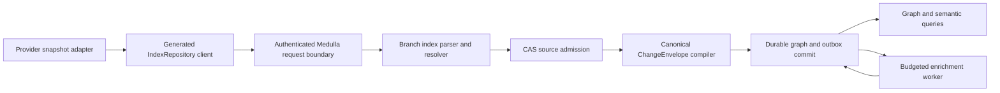

# MEDULLA-REPO-INGEST — Implementation plan

Governing spec: [spec.md](spec.md). Rows: [requirements.md](requirements.md).

## Summary

Medulla indexes a repository snapshot and ingests governed source observations through one writer. `Method::IndexRepository` and `Method::SourceIngest` enter at the dispatch boundary of `crates/medulla-server-router`, pass the graph ACL in `crates/medulla-server-graph`, and lower in `crates/medulla-h-ingest` to one `ChangeEnvelope` that commits in one durable transaction. Native parsing and resolution commit first. Heavy enrichment runs afterwards as durable, budgeted work through `crates/medulla-enrich`. The reuse candidates are the branch parser in `crates/medulla-compute/src/parser/`, the mutation outbox and the enrichment worker in `crates/medulla-h-ingest/src/repository_enrichment_worker.rs`.

## Technical Context

- **Language/Version**: Rust 2021 edition on the toolchain pinned by `rust-toolchain.toml`; Python 3.14 (floor 3.12) for served tests.
- **Primary Dependencies**: the workspace crates `medulla-h-ingest`, `medulla-server-graph`, `medulla-compute`, `medulla-document`, `medulla-enrich`, `medulla-durable`, `medulla-jobs` and the standard library. No model service is required.
- **Storage**: the durable graph store through the mutation gateway, the blob store for source bytes and the job store of `medulla-jobs`.
- **Testing**: crate unit tests, served tests under `crates/medulla-server-served-tests/src/split_tests/`, served Python tests under `tests/` and nightly benches.
- **Target Platform**: Linux x86_64 and aarch64 without AVX2 assumptions.
- **Project Type**: library crates and server handler crates.
- **Performance Goals**: native commit p99 at most 5 s on 5,000 files (`MEDULLA-REPO-INGEST-R006`); the nightly bench budgets of each hot-path row.
- **Constraints**: one graph writer; a refusal commits nothing; no host identity in durable text; limits of 48 MiB and 900,000 items per write set.
- **Scale/Scope**: the leaf rows of `requirements.md`, spread over 5 user stories.

## Constitution Check

- **R-I. The engine is native Rust and the only fact store**: pass. Every row lands in a Rust crate and the engine store.
- **R-II. Every wait has a deadline**: pass. Enrichment, hydration and intake run as jobs with budgets and deadlines.
- **R-III. Every row sets budgets and names a benchmark**: pass. Each hot-path row names a nightly bench with p50, p99 and memory.
- **R-IV. Crates are small, layered and cut over hard**: pass. Rows name the post-split crates and no handler crate calls a sibling handler crate.
- **Organization standards**: pass. Rows follow the spec standard and the wording standard.

## Project Structure

```text
crates/medulla-h-ingest/src/repository_index.rs        existing: lowering, commit budget, envelope build
crates/medulla-h-ingest/src/source_ingestion.rs        existing: SourceIngest prepare and finish
crates/medulla-h-ingest/src/web_ingest.rs              existing: document chunks
crates/medulla-h-ingest/src/repository_index/          new: enrich.rs (run_after_commit)
crates/medulla-h-ingest/src/                           new: ingest_throughput.rs, ingest_readback.rs, dead_letter.rs, transcript_intake.rs, code_health.rs, source_binding.rs
crates/medulla-server-graph/src/dispatch/              existing: change_envelope.rs, graph_pipeline/repository_index.rs
crates/medulla-enrich/src/                             existing: code, history, links, fingerprint
crates/medulla-document/src/                           existing: processing.rs, transcript.rs; new: skill_plan.rs, semantic_support.rs
crates/medulla-durable/src/                            existing: hydration.rs; new: adapters.rs
crates/medulla-h-mining/src/mining/                    existing: process.rs; new: ocel.rs
crates/medulla-types/src/                              existing: code_health.rs; new: skill_plan.rs, ingest_throughput.rs, ingest_readback.rs, code_map.rs, ingest_capabilities.rs
```

New files that rows add are marked `new` in their own `Shape:` sentence.

## Phase 0: Research

No unknowns; no research.md.

## Phase 1: Design

Data entities are in [data-model.md](data-model.md). The shortest served proof is in [quickstart.md](quickstart.md). Each seam to another repository has a document in `contracts/`.

### Authority and flow



The adapter is transport only. Medulla verifies graph write access before invoking parser work. The request boundary validates a portable repository-relative path, digest spelling, bounded scope, and feature availability. Parse and projection run off the network reactor. CAS admission can precede the graph transaction; a CAS holder has no graph visibility until the one envelope commits. The envelope is the sole graph writer for this path. The response is emitted after the commit, or on exact digest replay after reading its durable receipt.

`SourceIngest` is the parallel entrypoint for governed connector observations. It uses approved manifest mapping references, Medulla-computed live-set differences and the same `ChangeEnvelope` commit authority. A source-position bridge or index update is a consumer of that committed envelope, keyed by tenant, source ID, partition and position; it cannot reimplement graph mutation outside the envelope path.

### Entity and identity model

| Entity | Identity | Required durable fields |
|---|---|---|
| Repository | verified tenant + canonical repository ID | source kind, schema version, access class |
| Ref | repository + ref name | status and immutable current revision ID |
| Revision | repository + canonical immutable commit ID | parent IDs if supplied, observed time, evidence digest |
| Blob | content digest (stored under tenant/repository holder) | content reference, length, parser capability digest, parse disposition |
| FileVersion | repository + revision + normalized relative path + blob digest | path, blob link, validity and provenance |
| SymbolOccurrence | FileVersion + byte start/end + symbol kind + disambiguator | declaration name, language, span, parse evidence |
| Resolved edge | relation + source occurrence + target occurrence + algorithm/schema version | provenance, confidence when statistical |
| Work item | snapshot digest + enrichment kind + policy/admission version | budget, attempt, lease, state, output receipt |

Never key an occurrence solely by source text or blob digest: one blob can be mounted at different paths and refs, and identical declarations can appear twice. Branch membership is a relation to an immutable `FileVersion`; removing membership does not delete another ref's graph. Ref names can move, commit IDs cannot. Exact path normalization rejects absolute paths, traversal and URI-like host paths. Hash digests use lowercase `sha256:<64 hex>`.

The parser outcome is one `IndexFileOutcome` per submitted unique blob, preserving order. `success`, `unsupported` and `error` are distinct. A parse capability digest identifies the parser grammar/configuration so a later capability revision can retry failed/unsupported material without changing the immutable source digest. Diagnostics are bounded and machine readable. Rung evidence is derived inside Medulla and is not trusted from the request.

### Symbol resolution and semantic bridge

Parsing first produces file-local declarations and unresolved references. A deterministic second pass builds lookup indexes by language, module path, scope, exported name and arity. It resolves within the admitted snapshot, prioritizes exact receiver/import scope, and records ambiguity or external-package references as unresolved counts. Candidate ordering is canonical; neither filesystem enumeration nor hash-map order changes the result. Statistical `similar_to` edges require a versioned algorithm, score threshold, deterministic tie-break and provenance. An inferred target must already be an admitted node. `depends_on` connects actual source file versions, never raw import strings.

The semantic bridge projects typed relations for `declares`, `calls`, `inherits`, `realizes`, `depends_on`, `definedBy`, `testedBy`, `specifiedBy` and `releasedIn`. All relations point to stable graph IDs and carry the source evidence digest plus projection schema version. A spec, test or release artifact can enter only through authenticated source indexing or another approved ingestion contract. A missing target is recorded as unresolved rather than fabricated. Query permissions are evaluated before returning content or provenance. Bridge projection shares the envelope writer and tombstone rules.

### Atomicity, replay and recovery

Lowering canonicalizes properties and graph methods. It validates the complete operation and MessagePack item/byte budget, then hashes the write set. The envelope includes policy and privacy attestation, source references and provenance. It also includes tombstones and optional outbox intent. The graph version, projection, cursor/marker and receipt commit together. Identical request digests replay; same external id with different content is a conflict. Over-limit requests return `REPOSITORY_BATCH_TOO_LARGE` before graph commit. A client may split the batch; each split remains independently atomic and converges to the same final graph.

A restart reads the committed envelope and source marker from durable storage. Incomplete CAS admission is recoverable or garbage-collectable by holder policy but never advertised as indexed. Outbox leases are durable and fenced; a worker may reattempt after crash without duplicating a completed result. With replication enabled, write and worker submission require current placement/leader authority. An unsupported feature build returns a stable feature refusal; it cannot return a success shaped like an empty index.

### Security and operational decisions

- The verified request identity sets tenant and graph. A repository ID in payload is an identifier inside that authority, not an authorization credential.
- Preserve useful code text while replacing host identity in materialized properties. Raw bytes are tenant-scoped in CAS and subject to the graph's read policy.
- No live provider, credential, local inventory or model endpoint is needed for unit/contract tests. Provider adapters must supply their own reproducible fixtures.
- The native commit path is independent of enrichment. The worker uses engine-controlled admission, budget, grant and retry policy; model failure cannot roll back an already accepted native snapshot.
- Reuse the existing graph ACL, CAS, `ChangeEnvelope`, mutation outbox and generated contract mechanisms. New parser or projection abstractions need a demonstrated gap and a caller through the real service route.

### Recorded design decision: edge identity is the `(source, target, relation_type)` triple

The graph previously keyed some edges by endpoint pair alone, so multiple relation types between the same two endpoints had no canonical representation. Decided (operator-approved, MEDULLA-REPO-INGEST-R009.1/R009.2): an edge's identity is the triple `(source_id, target_id, relation_type)`, not the bare `(source_id, target_id)` pair. An untyped legacy edge migrates deterministically by reading its stored blob's `type`/`label` field as `relation_type`, falling back to `related_to` when neither is present; a migration collision (two untyped edges landing on the same triple) is resolved by a deterministic collapse rule and recorded in a collision receipt rather than silently dropped. The semantic bridge's nine relations (`declares`, `calls`, `inherits`, `realizes`, `depends_on`, `definedBy`, `testedBy`, `specifiedBy`, `releasedIn`) each project onto their own typed triple between the same two endpoints, so they never collide with each other or with an untyped edge.

Rejected alternatives:

- **Priority rule.** Pick one relation type to "win" per endpoint pair by a fixed precedence order. Rejected: it is not a representation at all — every lower-priority relation between the same two endpoints is unrepresentable the moment a higher-priority one exists, which is exactly the silent-drop failure mode this decision exists to close.
- **Set-of-types on one edge.** Keep one edge per endpoint pair and widen its `relation_type` field to a set. Rejected: it collapses distinct relations' independent properties, provenance and lifecycle (add/remove/invalidate timing) onto one shared record, and a removal of one type cannot be expressed without either deleting the whole edge or mutating the set in place with no edge-level audit trail.
- **Reified relation nodes.** Model each relation as its own graph node with edges to its source and target. Rejected: it multiplies node count by the relation volume, forces every relation-aware query through an extra hop, and provides no benefit over a typed edge for a binary relation that carries no further relations of its own.

### Inventory authority and identity binding for the code map

These Medulla contracts extend `MEDULLA-REPO-INGEST-R006.3` and `MEDULLA-REPO-INGEST-R006.4`. All fields are required.
Text IDs are nonempty UTF-8; counters are unsigned 64-bit integers; digests
are lowercase `sha256:<64 hex>`. Unknown fields and missing bindings refuse.

`RepositoryInventoryAuthority` = `{tenant, repository_id, ref_name, binding_id, binding_revision, publisher_principal, source_binding_ref, source_binding_revision, source_binding_digest, provenance_ref, provenance_digest}`.
Admit through existing governed ChangeEnvelope authorization and expected
binding revision. Verified tenant and graph authority control admission;
payload principal does not grant permission. The binding selects an explicit
publisher/source without assigning either role to connector SDK transport or Arbora/Meristem.
The publisher must have current graph write authority at every submission.

`AdvanceRepositoryInventory` = `{binding_id, binding_revision, expected_inventory_revision, source_event_id, source_revision, inventory_digest, files}`. Each file is `{path, blob_digest, byte_length}`. Paths are unique,
normalized repository-relative paths. The list is the complete source snapshot,
canonically sorted by UTF-8 path bytes. Inventory digest hashes canonical JSON
of this list (RFC 8785). Source revision is an immutable provider revision,
not a guessed remote HEAD. Verified caller must match the admitted publisher;
source binding and provenance must validate against the submitted revision.
Output = `{binding_id, binding_revision, inventory_revision, source_revision, inventory_digest, graph_revision, source_event_id}`. The proposed operation
extends the existing SourceIngest preparation and ChangeEnvelope commit path
in `crates/medulla-h-ingest/src/source_ingestion.rs`. It atomically compares expected
inventory revision, increments it, stores the complete manifest and receipt,
and invalidates the prior current-map binding. No partial inventory is current.
Identical source event/payload replays the receipt; conflicting replay, stale
CAS, unknown binding, incomplete manifest or unauthorized publisher stores nothing.

`PublishRepositoryMap` = `{binding_id, binding_revision, inventory_revision, inventory_digest, source_revision, expected_map_generation, map_digest, identity_scheme, parser_digest, complete}`. Output adds `{map_generation, graph_revision}` to these fields. `complete` must be true. Every admitted file must have an explicit parse outcome, including unsupported/error outcomes.
Unsupported relations remain incomplete. Medulla publishes only after comparing the
current inventory and all native IndexRepository/SourceIngest results in one
ChangeEnvelope. A failed/raced publish keeps the old map historical, never current.
Every UnifiedQuery page and cursor checks authority, inventory revision/digest,
map generation/digest and source revision before data, counts or cursors.
Missing inventory and an advanced inventory without a complete matching map refuse.

The identity scheme is the existing branch parser projection, pinned by its
source revision/digest in `identity_scheme` = `{source_revision, source_digest}`.
Reuse `branch_index::ParseUnits::build` / `unit_name`,
`tree_sitter_walk::{emit_symbol,hash_fields}`, and
`branch_scope::{blob_node_id,file_version_id,branch_node_id}` under
`crates/medulla-compute/src/parser/`. Symbols hash length-prefixed parse-unit path,
symbol type, qualified name and ordinal; branch parse-unit paths bind blob
content and grammar suffix. FileVersion binds repository/path/blob; Branch
binds repository/ref. Revision and current path/span are query bindings through
`branch_projection::project_scope`, not a new symbol-ID hash. Unchanged file content retains symbol IDs in a new repository revision. Changed
blobs may change IDs. Same-content renames retain symbol IDs only with unchanged grammar suffix and parser/identity scheme. File-version and membership still change. A changed grammar suffix or parser/identity scheme requires reparse and may change symbol IDs. Deleted membership is absent from the new map. No promise
of stable IDs across edits to the same blob is introduced. Preserve typed edge
identity under R009.1/R009.2 and `MEDULLA-TYPED-PACKS-R069` semantic projection ownership.

## Phase 2: Task approach

`tasks.md` holds one task per leaf row. Producer rows come first: the contract and identity rows (`R009.1`, `R009.2`, `R007`, `R008`), then the native commit rows, then the post-commit enrichment rows (`R600` to `R603`), then the intake, hydration and adapter rows (`R650` to `R652`, `R800`). Tasks of independent crates may run in parallel.

## Complexity Tracking

None.

## Build contract

The numbers come from `.config/kiss.toml`, `.config/pre-commit.yaml` and `[tool.medulla.scanners]`.

- **KISS:** at most 35 statements, 8 arguments, 20 local variables and 45 calls per function. At most 900 lines, 250 statements and 40 functions per file. Indentation depth 5. No cycles.
- **cccc:** no new function over cyclomatic 10 or cognitive 15, and none may regress.
- **dupehound:** similarity threshold 0.85 with at least 40 tokens.
- **jscpd:** at least 50 tokens and 5 lines in mild mode. New clone pairs fail the gate.
- **Commands:** `pre-commit run --config .config/pre-commit.yaml --all-files`, `bash scripts/ci_parity.sh` and `python3 scripts/check_complexity_staged.py`.

Shapes: lowering stays in `repository_index.rs`; a new write path reuses `ChangeEnvelope`; no second graph writer; move helpers, do not copy them.

## Production caller chain

A caller sends `Method::IndexRepository` or `Method::SourceIngest`. `crates/medulla-server-router/src/dispatch/router/source_ingest.rs::dispatch_source_ingest_methods` hands scoped and durable work to `crates/medulla-server-graph/src/dispatch/graph_pipeline/native_routes.rs::route_source_ingestion_dispatch` (`:415`). That function routes to `repository_index.rs::route_repository_index` (`:208`) or `route_source_ingestion_request` (`:467`). The handlers in `crates/medulla-h-ingest/src/repository_index.rs` (`lower` `:115`, `finish` `:303`) and `source_ingestion.rs` (`prepare` `:167`, `finish` `:1743`) build the envelope and commit it through the mutation gateway. Post-commit enrichment attaches in `finish` through `run_after_commit`. Envelope applies enter through `crates/medulla-server-router/src/dispatch/router/data_plane.rs` (`:673`) and `crates/medulla-server-graph/src/dispatch/change_envelope.rs::apply_one_change_envelope` (`:588`). No alternate graph mutation path may stay once its callers use this path.

## Cross-repo seams

- The connector transport (`SCION-REPOSITORY-TRANSPORT-R004`, `SCION-SOURCE-INGEST-R004.13`) sends batches and halves them on `REPOSITORY_BATCH_TOO_LARGE`: [contracts/scion-repository-transport.md](contracts/scion-repository-transport.md).
- The host admits and runs skill plans and grants working memory (`ARBORA-HOST-R001.2.1.2`, `ARBORA-CAPACITY-R753`): [contracts/arbora-host-skill-compile.md](contracts/arbora-host-skill-compile.md).
